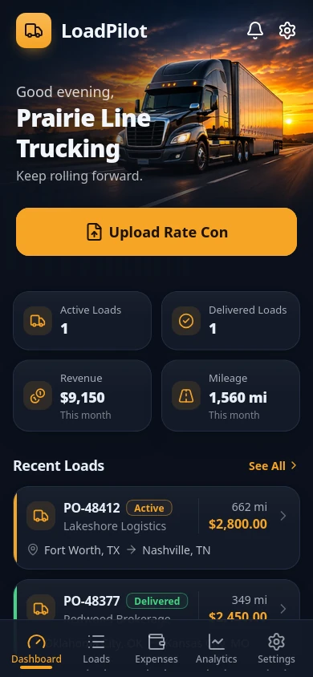
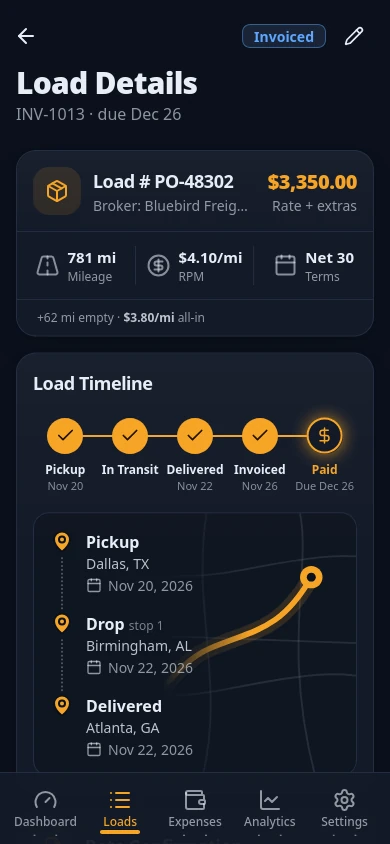
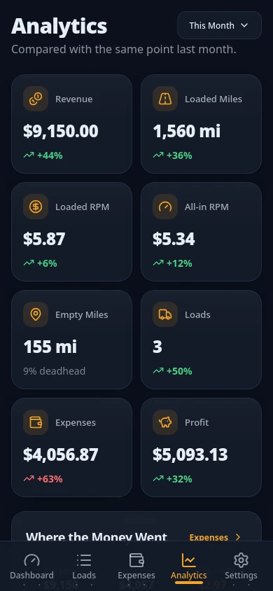
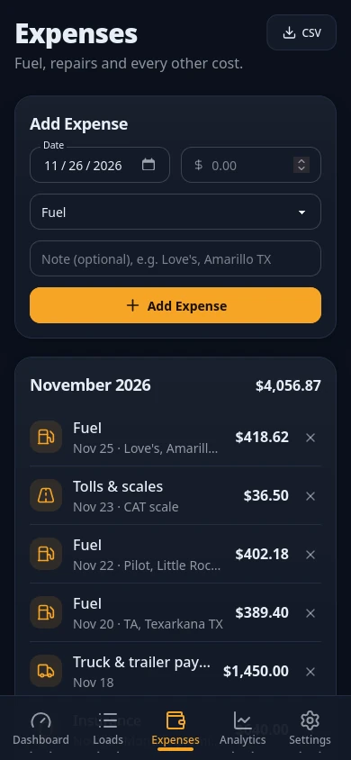

# LoadPilot

**Load management and invoicing for owner-operator truck drivers.** Scan a rate con, track the load from pickup to payment, send the invoice with the signed BOL attached, and see what you actually made per mile. It runs on your own server, and it's built for your phone.

<p align="center">
  
  
  
  
</p>

## What it does

- **Scan rate cons with AI.** Upload the PDF or a photo, and the broker, load number, rate, stops, dates and miles fill themselves in. Bring your own key for Google Gemini, OpenAI or OpenRouter.
- **Follow every load** from Active to Delivered, Invoiced and Paid, including multi-stop loads. It estimates empty (deadhead) miles from your last delivery, and remembers brokers you've hauled for.
- **Build the invoice in one tap.** Attach the signed BOL, and LoadPilot makes a PDF invoice with the BOL as its last page. Add detention, layover, lumper or TONU charges, and rebuild the invoice if they change.
- **Email it to the broker** from the load page, through your own email account.
- **Get paid on time.** Payment terms, due dates and overdue invoices are on the dashboard. Record short pays and quick-pay fees when you mark a load paid.
- **Know your numbers.** Revenue, loaded and all-in RPM, deadhead percentage, top brokers, and your expenses (fuel, the truck payment, insurance, repairs), so you see profit and profit per mile, not just gross.
- **Keep your data.** Export loads and expenses as CSV for your accountant, and download a full backup in one tap.
- **Install it on your phone.** It's a web app you add to your home screen, with no app store involved.
- **Connect other apps** with an API token, for example a bank feed that marks invoices paid.

## Quick start

You need a machine that's always on (a home server, a NAS, a Raspberry Pi 4 or 5, or a small VPS) with [Docker](https://docs.docker.com/engine/install/). Images are built for x86-64 and ARM64.

1. Save [`docker-compose.yml`](docker-compose.yml) in a new folder, and set `TZ` in it to your time zone.
2. Start LoadPilot:

   ```sh
   docker compose up -d
   ```

3. Open `http://<that machine>:8000` and create your account.
4. In **Settings**, add your company details (they go on invoices), payment terms and, optionally, an AI key and your email account.

To use it away from home, put it behind a reverse proxy with HTTPS. See [Behind a reverse proxy](#behind-a-reverse-proxy).

On your phone, open LoadPilot in the browser, then choose **Add to Home Screen** (Safari) or **Install app** (Chrome).

## Configuration

Everything else is set in the app, under **Settings**. The container reads these environment variables:

| Variable | Default | What it's for |
|---|---|---|
| `TZ` | `UTC` | Your time zone, e.g. `America/Chicago`. "Today" for delivery, invoice and due dates follows it. |
| `PUID`, `PGID` | `1000` | The user LoadPilot runs as and who owns the data folder. Set them to your own (`id -u`, `id -g`) if your data folder belongs to someone else. |
| `FORWARDED_ALLOW_IPS` | `127.0.0.1,::1` | Behind a reverse proxy: the proxy's address or network, or `*`. See below. |
| `GEMINI_API_KEY`, `OPENAI_API_KEY`, `OPENROUTER_API_KEY` | none | Optional AI keys for scanning rate cons. A key saved in Settings takes priority. |
| `LOADPILOT_SECRET_KEY` | generated | Signs login cookies. It's generated and saved in the data folder on first start, so you rarely need it. |
| `LOADPILOT_DATA_DIR` | `/config` | Where LoadPilot keeps its data inside the container. |

### Your data

Everything lives in the folder mounted at `/config`:

```
config/
├── loadpilot.db   # loads, expenses, settings and your account
├── ratecons/      # rate confirmations
├── bols/          # signed BOLs
├── invoices/      # invoice PDFs
├── logs/
└── secret_key
```

### Behind a reverse proxy

For HTTPS and access from anywhere, put LoadPilot behind a reverse proxy such as [Caddy](https://caddyserver.com). With Caddy, this is the whole `Caddyfile`:

```caddyfile
loads.example.com {
    reverse_proxy loadpilot:8000   # or 127.0.0.1:8000 if Caddy isn't in Docker
}
```

The proxy passes on each visitor's real address and tells LoadPilot the connection is HTTPS. LoadPilot only trusts that information from addresses in `FORWARDED_ALLOW_IPS`:

- **Only the proxy can reach LoadPilot** (it's on the same Docker network and the `ports:` line is removed, or the port is published as `127.0.0.1:8000:8000`): set `FORWARDED_ALLOW_IPS: "*"`.
- **Otherwise**, set it to the proxy's address or network, for example `172.16.0.0/12` for Docker's usual networks.

If it isn't set, everyone appears to come from the proxy. Then a stranger's wrong passwords lock you out for 15 minutes, and the login cookie isn't marked secure. LoadPilot logs a warning in `docker logs loadpilot` naming the address to use.

### Email

To email invoices, open **Settings → Invoice Email** and enter your email provider's SMTP server. Then use **Send Test Email**.

| Provider | Server | Port | Password |
|---|---|---|---|
| Gmail | `smtp.gmail.com` | 587 | An [app password](https://myaccount.google.com/apppasswords) (needs 2-Step Verification), not your normal one |
| Others (Fastmail, Zoho, your web host, ...) | Their SMTP server | 587 or 465 | Often an app password; check your provider's help pages |

LoadPilot always encrypts the connection. It won't send your password to a server that can't.

## Backups and updates

**Backup:** **Settings → Export & Backup → Download Backup** gives you a zip of the database and every rate con, BOL and invoice. Copying the `config` folder also works.

**Restore:** stop LoadPilot, unzip the backup into an empty `config` folder, and start it again. You'll need to sign in again on each device.

**Update:**

```sh
docker compose pull && docker compose up -d
```

Database changes are applied automatically when LoadPilot starts. Each one either completes fully or not at all, so a failed upgrade is simply retried next time. Releases follow [semantic versioning](https://semver.org): pin the image to a major version (`:1`) to get fixes and features without breaking changes. See the [changelog](CHANGELOG.md) for what changed.

## Admin commands

Run these on the server:

```sh
# Forgot your password? Set a new one (signs out every device)
docker exec -it loadpilot python -m loadpilot.cli reset-password

# List rate cons, BOLs and invoices that no load links to any more; add --delete to remove them
docker exec -it loadpilot python -m loadpilot.cli clean-documents
```

## API

Create a token in **Settings → API Access**, then send it as `Authorization: Bearer <token>`. For example, to record a broker payment:

```sh
curl -X POST https://loads.example.com/api/payments/ \
  -H "Authorization: Bearer lp_..." \
  -H "Content-Type: application/json" \
  -d '{"invoice_number": "INV-1001", "amount": 2450}'
```

The token opens the API (`/api/loads/`, `/api/payments/`) and nothing else. Every endpoint is listed at `/docs` when you're signed in.

## Development

LoadPilot is a [FastAPI](https://fastapi.tiangolo.com) app with server-rendered pages ([htmx](https://htmx.org), [Tailwind CSS](https://tailwindcss.com) and [daisyUI](https://daisyui.com)), SQLite and [WeasyPrint](https://weasyprint.org) for PDFs. It needs Python 3.14, and the libraries WeasyPrint uses (`libpango-1.0-0 libpangoft2-1.0-0 libharfbuzz-subset0` on Debian and Ubuntu).

```sh
uv venv --python 3.14 && source .venv/bin/activate
uv pip install -r requirements-dev.txt
scripts/build-css.sh                       # add --watch to rebuild as you edit templates
LOADPILOT_DATA_DIR=./config uvicorn app:app --reload
```

Run the checks that CI runs:

```sh
ruff check . && ruff format --check . && pytest
```

Commit messages follow [Conventional Commits](https://www.conventionalcommits.org) (`feat:`, `fix:`, ...). [release-please](https://github.com/googleapis/release-please) turns them into versioned releases and Docker images on `ghcr.io/fahmula/loadpilot`.
